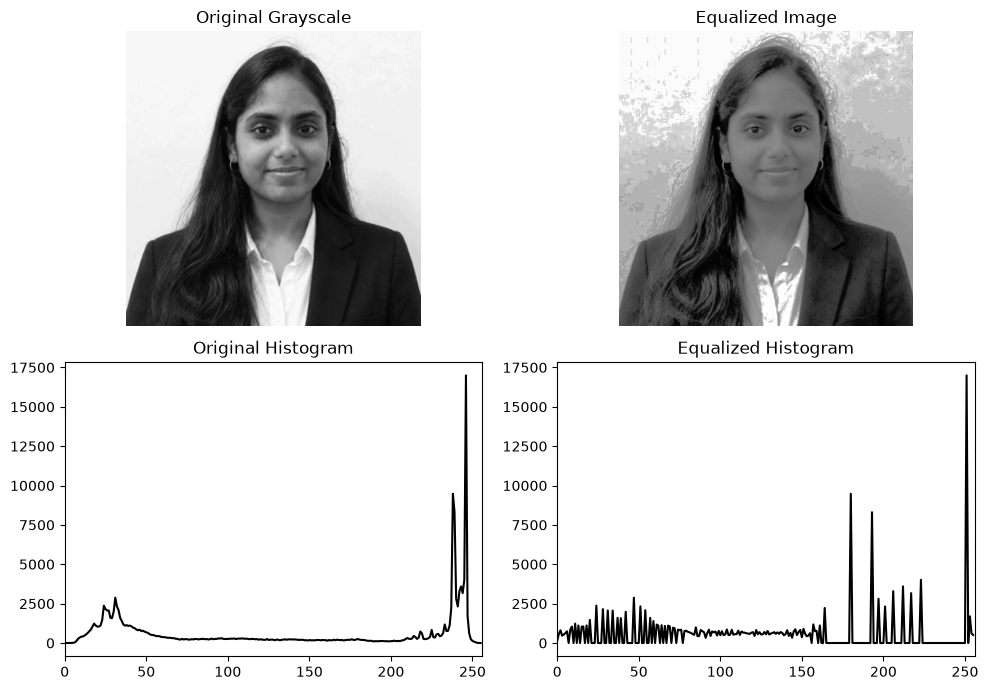
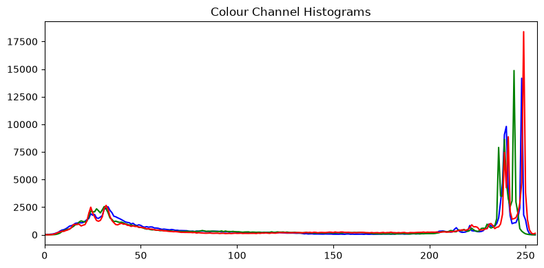

# EXP-3: Histogram Image Processing

## Experiment Details

- **Name:** Ramitha Chowdary S
- **Register Number:** 212224240130

## Aim

Find how often each pixel value from 0 to 255 shows up in a photo, then spread those values out with histogram equalization.

## Software Required

- Anaconda
- Python 3
- Jupyter Notebook
- OpenCV
- NumPy
- Matplotlib

## Algorithm

**Step 1:** Read ramitha.png and turn it into grayscale.

**Step 2:** Count the grayscale pixel values with cv2.calcHist().

**Step 3:** Equalize that grayscale image with cv2.equalizeHist().

**Step 4:** Count the pixel values again on the equalized image.

**Step 5:** Show the before and after photos next to their histograms.

**Step 6:** Split the colour photo into blue, green and red and plot those three histograms.

## Program

#### 1. Read the photo

```python
import cv2
import numpy as np
import matplotlib.pyplot as plt

photo = cv2.imread("ramitha.png")
gray = cv2.cvtColor(photo, cv2.COLOR_BGR2GRAY)
```

#### 2. Grayscale histogram and equalization

```python
hist_before = cv2.calcHist([gray], [0], None, [256], [0, 256])
equalized = cv2.equalizeHist(gray)
hist_after = cv2.calcHist([equalized], [0], None, [256], [0, 256])

plt.figure(figsize=(10, 7))
plt.subplot(2, 2, 1)
plt.imshow(gray, cmap="gray")
plt.title("Original Grayscale")
plt.axis("off")
plt.subplot(2, 2, 2)
plt.imshow(equalized, cmap="gray")
plt.title("Equalized Image")
plt.axis("off")
plt.subplot(2, 2, 3)
plt.plot(hist_before, color="black")
plt.title("Original Histogram")
plt.xlim([0, 256])
plt.subplot(2, 2, 4)
plt.plot(hist_after, color="black")
plt.title("Equalized Histogram")
plt.xlim([0, 256])
plt.tight_layout()
plt.show()
```

#### 3. Histograms of the colour channels

```python
blue, green, red = cv2.split(photo)
plt.figure(figsize=(8, 4))
plt.plot(cv2.calcHist([blue], [0], None, [256], [0, 256]), color="blue")
plt.plot(cv2.calcHist([green], [0], None, [256], [0, 256]), color="green")
plt.plot(cv2.calcHist([red], [0], None, [256], [0, 256]), color="red")
plt.title("Colour Channel Histograms")
plt.xlim([0, 256])
plt.tight_layout()
plt.show()
```

## Output

### i) Grayscale image and its equalization



### ii) Colour channel histograms



## Result

The grayscale histogram was plotted and the photo was equalized. The blue, green and red histograms were plotted as well.
