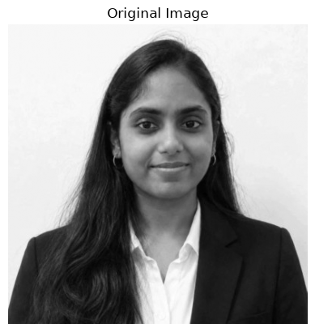
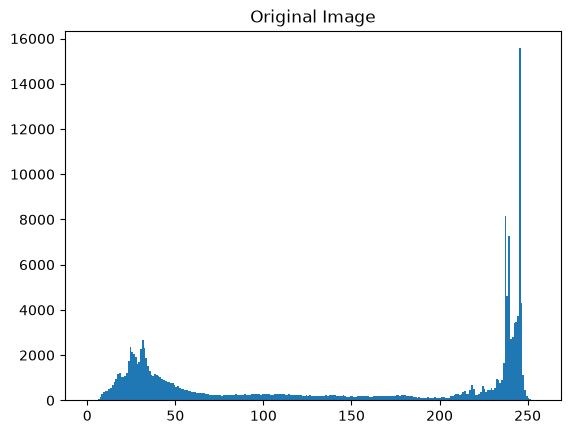
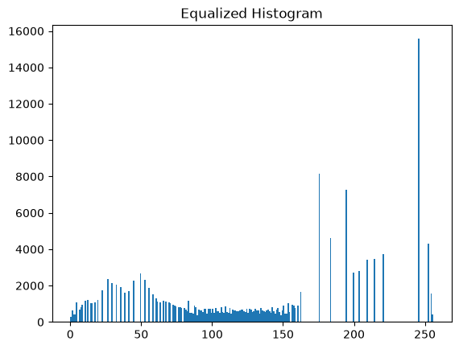
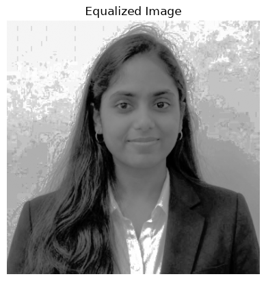
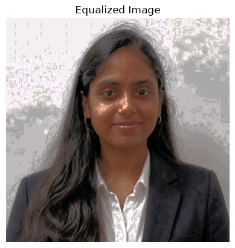
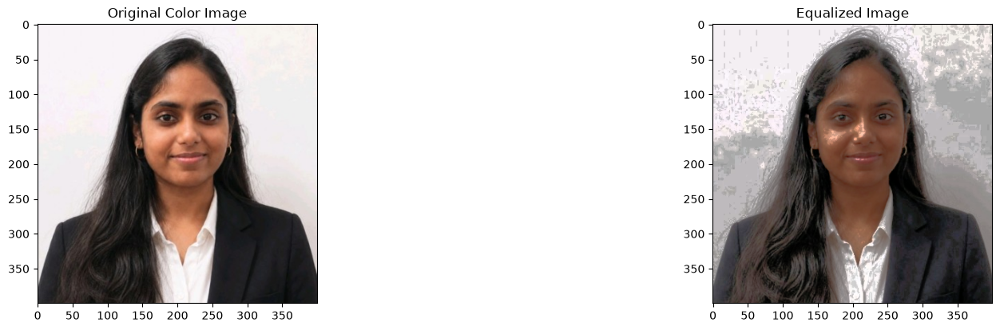

# EXP-3: Histogram Image Processing

## Experiment Details

- **Name:** Ramitha Chowdary S
- **Register Number:** 212224240130

## Aim

Find how often each pixel value from 0 to 255 shows up in a photo, then spread those values out with histogram equalization.

## Software Required

- Anaconda
- Python 3
- Jupyter Notebook
- OpenCV
- NumPy
- Matplotlib

## Algorithm

**Step 1:** Read ramitha.png and turn it into grayscale.

**Step 2:** Count the grayscale pixel values with cv2.calcHist().

**Step 3:** Equalize that grayscale image with cv2.equalizeHist().

**Step 4:** Count the pixel values again on the equalized image.

**Step 5:** Show the before and after photos next to their histograms.

**Step 6:** Split the colour photo into blue, green and red and plot those three histograms.

## Program

#### 1.

```python
import cv2
import numpy as np
import matplotlib.pyplot as plt
```

#### 2.

```python
img = cv2.imread('ramitha.png', cv2.IMREAD_GRAYSCALE)
```

#### 3.

```python
plt.imshow(img, cmap='gray')
plt.title('Original Image')
plt.show()
```

#### 4.

```python
plt.hist(img.ravel(),256,range = [0, 256]);
plt.title('Original Image')
plt.show()
```

#### 5.

```python
img_eq = cv2.equalizeHist(img)
```

#### 6.

```python
plt.hist(img_eq.ravel(), 256, range = [0, 256])
plt.title('Equalized Histogram')
```

#### 7.

```python
plt.imshow(img_eq, cmap='gray')
plt.title('Original Image')
plt.show()
```

#### 8.

```python
img = cv2.imread('ramitha.png', cv2.IMREAD_COLOR)
```

#### 9.

```python
img_hsv = cv2.cvtColor(img, cv2.COLOR_BGR2HSV)
```

#### 10.

```python
img_hsv[:,:,2] = cv2.equalizeHist(img_hsv[:, :, 2])
```

#### 11.

```python
img_eq = cv2.cvtColor(img_hsv, cv2.COLOR_HSV2BGR)
```

#### 12.

```python
plt.imshow(img_eq[:,:,::-1]); plt.title('Equalized Image');plt.show()
```

#### 13.

```python
plt.hist(img_eq.ravel(),256,range = [0, 256]); plt.title('Histogram Equalized');plt.show()
```

#### 14.

```python
plt.figure(figsize = (20,10))
plt.subplot(221); plt.imshow(img[:, :, ::-1]); plt.title('Original Color Image')
plt.subplot(222); plt.imshow(img_eq[:, :, ::-1]); plt.title('Equalized Image')
plt.show()
```

#### 15.

```python
plt.figure(figsize = [15,4])
plt.subplot(121); plt.hist(img.ravel(),256,range = [0, 256]); plt.title('Original Image')
plt.subplot(122); plt.hist(img_eq.ravel(),256,range = [0, 256]); plt.title('Histogram Equalized')
```

## Output













## Result

The grayscale histogram was plotted and the photo was equalized. The blue, green and red histograms were plotted as well.
